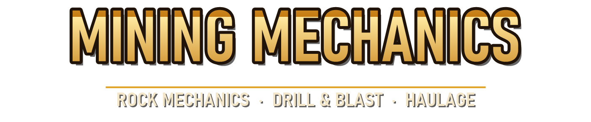
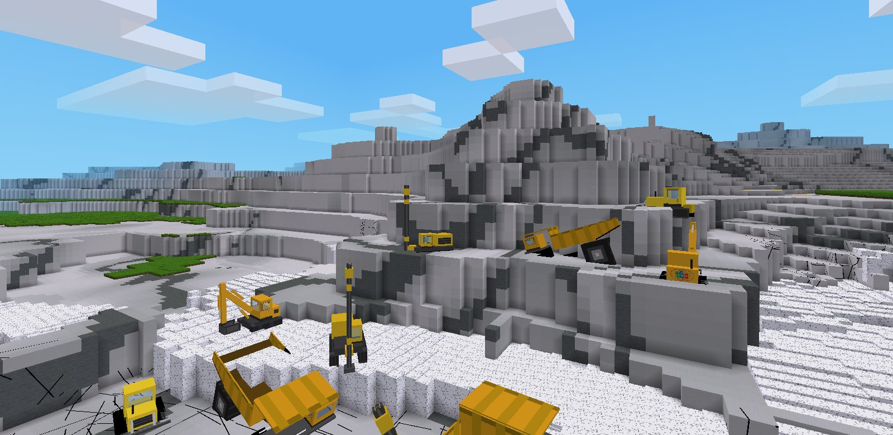

GeoRocker 是一款岩石力學、隧道與大地工程的採礦模擬遊戲，以 [Luanti](https://www.luanti.org/) 引擎製作。
玩家要自己探勘地質、鑽孔爆破、開挖支撐、運輸賣礦。岩體會依應力和節理崩塌，炸藥配比不對威力就打折。

*A rock mechanics and mining simulator built on the Luanti engine. Text in game is Traditional Chinese.*

**📖 遊戲說明（wiki）：https://jatestrella.github.io/GeoRocker/**

## 遊戲內容

- **岩體與開挖**：完整岩石加節理；應力、岩體強度、穩定性與崩塌
- **探勘**：岩芯鑽探、地質羅盤、GSI、Q 法、施密特錘、點荷重、孔內應力計
- **爆破**：鑿岩、裝藥、自己調配 ANFO（硝酸銨與柴油的比例決定威力）
- **支撐**：岩栓、噴凝土、木支撐、通風與空氣品質
- **機具與運輸**：怪手、推土機、礦卡、鑽機、裝藥車、輸送帶、收煤站
- **經營**：資金、礦價與市場事件、截止品位、貸款

## 地圖

| 地圖 | 說明 |
|---|---|
| 煤礦經營（單機） | 固定地質，從頭經營一座煤礦 |
| 隨機煤礦（單機） | 每次地質都不一樣 |
| 自訂煤礦（單機） | 自己設定地層、煤層、褶皺 |
| 水泥礦（單機） | 仿花蓮和平礦場山頂採場，1:1 地形 |

## 下載與安裝

不用另外安裝任何東西，遊戲引擎已經包在裡面。

| 系統 | 下載 | 開始玩 |
|---|---|---|
| Windows | [GeoRocker.zip](https://github.com/jatestrella/GeoRocker/releases/latest/download/GeoRocker.zip) | 解壓縮後點兩下 `開始遊戲.bat` |
| macOS 12.3 以上（Apple 晶片、Intel 都可以） | [GeoRocker_mac.zip](https://github.com/jatestrella/GeoRocker/releases/latest/download/GeoRocker_mac.zip) | 解壓縮後對 `開始遊戲.command` 按右鍵 →「打開」（第一次才要，之後點兩下就好） |

舊版本在 [Releases](https://github.com/jatestrella/GeoRocker/releases)。

**Linux**：先安裝 [Luanti](https://www.luanti.org/) 5.15，再下載本 repo（綠色 **Code** 按鈕 → Download ZIP），把解壓出來的資料夾**改名為 `georocker`**，放進 Luanti 的 `games` 資料夾，開 Luanti 選 GeoRocker 建立新世界。這種裝法沒有 GeoRocker 的開始畫面，建立的世界會用預設地圖。

## 意見與合作

問題回報、教學使用或合作詢問，請開 [Issue](https://github.com/jatestrella/GeoRocker/issues)。

## 第三方素材

| 素材 | 出處 | 授權 |
|---|---|---|
| 遊戲引擎 | [Luanti](https://www.luanti.org/)（Windows、macOS 下載包內附） | LGPL-2.1+ |
| `mods/default`、`stairs`、`doors`、`fire`、`tnt`、`sfinv`、`creative`、`player_api` | [Minetest Game](https://github.com/luanti-org/minetest_game) | 程式 LGPL-2.1+ 或 MIT；圖片、音效 CC BY-SA 3.0 等，作者與細節見各資料夾的 `license.txt` |
| 字型 `fonts/Cubic_11.ttf` | [俐方體 11 號（Cubic 11）](https://github.com/ACh-K/Cubic-11) | SIL Open Font License 1.1 |

GeoRocker 有些方塊直接使用 Minetest Game 的貼圖（例如玻璃、泥土、碎石、草），這些貼圖仍依原授權，作者權利歸原作者。

## 授權

保留所有權利，僅公開閱覽，詳見 [LICENSE](LICENSE)。
上表的第三方素材依其原授權，不在此限。

## 聲明

GeoRocker 是獨立製作的遊戲，與 Mojang Studios、Microsoft 及 Minecraft 沒有任何關係，也未經其認可或贊助。Minecraft 是 Mojang Synergies AB 的商標。

*GeoRocker is an independent game. It is not affiliated with, endorsed by, or sponsored by Mojang Studios, Microsoft, or Minecraft. Minecraft is a trademark of Mojang Synergies AB.*
